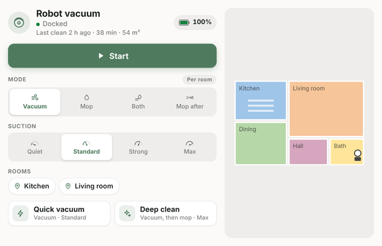

# Vacuum

A robot vacuum from Home Assistant on one HomeGlow tile.



- **Start, pause and dock**, with what it's doing and the battery.
- **Mode and suction**, when your vacuum has them as select entities in Home Assistant.
- **Clean buttons** that run your own scripts, like *Quick vacuum* or *Deep clean*.
- **Room buttons** (optional): one tap cleans a room.
- **Last clean**: when, how long and how much area. While cleaning: area and time so far.
- **Station alerts**: empty water tank, full dust bag, worn brush or filter, and errors.
- **Map** beside the controls on wide tiles, or behind the map button on small ones.
- **More than one vacuum**: a tab for each, or swipe between them.
- **Floors**: pick which floor's map to clean, for vacuums that keep a map per floor.

## Works with other vacuums

The card finds your vacuum and its settings on its own. Rows your vacuum doesn't have are left off. If it has no suction setting, there's no Suction row, rather than one that says unavailable.

Mode and suction show only when your vacuum's integration has them as **select** entities (the Dreame integration does, for example). HomeGlow doesn't pass a vacuum's own fan-speed list to plugins, so vacuums that only have that won't get a Suction row.

## Install

1. In HomeGlow, go to **Admin → Plugins**, find **Vacuum** under Household, and install it. Approve the Home Assistant access it asks for.
2. Add the **Vacuum** widget to your dashboard.

**Map (optional).** HomeGlow only shows a camera that the plugin names, and this one names `camera.vacuum_map`. Either of these gets your map on the card:

- In Home Assistant, rename your map camera's entity ID to `camera.vacuum_map` (open the camera, then ⋮ → **Settings**). Nothing else changes.
- Or download [`Vacuum.html`](Vacuum.html), open it in a text editor, change `"camera.vacuum_map"` near the top to your camera, such as `"camera.robot_map"`, and upload that file in **Admin → Plugins** instead.

With a second vacuum, its map camera is `camera.vacuum_map_2`, and each vacuum shows the map camera on its own device.

The map has to be a **camera** entity, as the Dreame integration and Xiaomi Cloud Map Extractor provide. Integrations that provide the map as an **image** entity instead, like Home Assistant's built-in Roborock integration, can't show it on the card yet. Everything else works without a map.

**About the access it asks for.** The card controls your vacuum and its selects, and runs scripts for the clean and room buttons. HomeGlow grants these by type, so it asks for all vacuums, selects, switches and scripts, plus sensors to read. The card only touches the vacuum, its settings and the scripts you list.

## Clean buttons

Each button runs a Home Assistant script. The card comes with two buttons that use these names:

| Button | Script |
|---|---|
| Quick vacuum | `script.vacuum_quick` |
| Deep clean | `script.vacuum_deep_clean` |

A button whose script doesn't exist is hidden, so nothing shows until you make them.

The easy way is the blueprint. Click the button, then in Home Assistant make a script from it for each clean button:

[](https://my.home-assistant.io/redirect/blueprint_import/?blueprint_url=https%3A%2F%2Fgithub.com%2Fjherforth%2FHomeGlowPlugins%2Fblob%2Fmain%2FVacuum-clean-button.yaml)

1. **Settings → Automations & scenes → Blueprints → Vacuum clean button (HomeGlow) → Create script.**
2. Pick your vacuum, and the mode and suction to use. Leave anything your vacuum doesn't have empty.
3. Save it, and set the **Entity ID** (in ⋮ → **Settings**) to `script.vacuum_quick`. Repeat for `script.vacuum_deep_clean`.

To change the buttons, edit **Clean buttons** in Plugin Options: `Name = script`, separated by semicolons. A short note after a `|` shows under the name, so it can say what that script does. For example:

```
Quick vacuum | Vacuum · Standard = script.vacuum_quick; Deep clean | Vacuum, then mop · Max = script.vacuum_deep_clean
```

## Room buttons

Turn on **Show room buttons** in Plugin Options, then list each room and the script it runs:

```
Kitchen = script.vacuum_kitchen; Living room = script.vacuum_living_room
```

Each button cleans one room with whatever mode and suction the card is set to.

**Dreame vacuums** ([Dreame Vacuum integration](https://github.com/Tasshack/dreame-vacuum)): use this blueprint. It finds rooms by the names in the Dreame app.

[](https://my.home-assistant.io/redirect/blueprint_import/?blueprint_url=https%3A%2F%2Fgithub.com%2Fjherforth%2FHomeGlowPlugins%2Fblob%2Fmain%2FVacuum-dreame-rooms.yaml)

Make a script from it for each room, type the room's name, and set its Entity ID, such as `script.vacuum_kitchen`.

**Other vacuums:** make a script that cleans that room with your integration's own room or segment action, and give it the name you list.

## More than one vacuum, or more than one floor

With two or more vacuums, the card shows one at a time, with a tab for each at the top. Each tab has a dot for that vacuum's state, so you can see one is cleaning while looking at the other. Tap a tab or swipe across the card to switch. Each screen remembers the vacuum it was last on.

The card finds every vacuum on its own. To choose which ones show, their order, or their names on the tabs, list them in **Vacuums**:

```
Upstairs = vacuum.robot_up; Downstairs = vacuum.robot_down
```

Each vacuum finds its own mode, suction, battery and map. If you set one of those by hand, list one entity per vacuum, separated by semicolons. Each vacuum uses the one on its own Home Assistant device.

**Floors.** A vacuum that keeps a map per floor (Dreame and Roborock have a *Selected map* setting) gets a **Floor** row. Changing it changes which floor the vacuum cleans.

**Buttons for one vacuum or one floor.** Start a clean or room button with a vacuum's or a floor's name and a colon. It then shows only on that vacuum's tab, or while that floor is picked. Buttons without a name show everywhere:

```
Quick vacuum = script.vacuum_quick; Upstairs: Bedroom = script.vacuum_bedroom; Basement: Laundry = script.vacuum_laundry
```

## Plugin Options

| Setting | What it does |
|---|---|
| Vacuums | Blank shows every vacuum, a tab each. Or list them, with names: `Upstairs = vacuum.robot_up; Downstairs = vacuum.robot_down`. |
| Floor | The select that picks a vacuum's map. Blank finds it, `-` hides it. |
| Cleaning mode, Suction, Battery | The entities for each. Blank finds them on the vacuum's device. Type `-` to hide a row. With more than one vacuum, list one per vacuum. |
| Per-room settings switch | A switch like Dreame's Customized Cleaning, shown as **Per room**. Blank finds it, `-` hides it. |
| Clean buttons | See above. Start one with a vacuum's or floor's name and a colon to show it only there. |
| Show room buttons, Room buttons | See above. Room buttons take a vacuum's or floor's name the same way. |
| Show the map | Turn off to keep the map hidden on this screen. |

Last clean uses your vacuum's last-clean sensors when it has them. Otherwise the card remembers the end of each clean it sees, for each vacuum.
